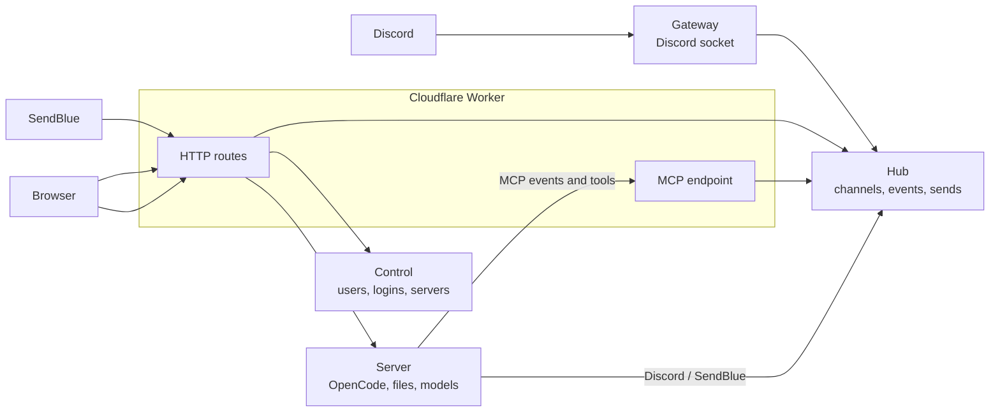

# Eryn

Eryn is a personal agent you can reach from a messaging surface. It runs a
hosted [OpenCode](https://opencode.ai) agent in a Cloudflare Durable Object and
connects it to Discord or iMessage through a small provider layer.

The redesign in this branch removes Discord from the core. Discord and iMessage
are providers; the agent, its workspace, its inference, and its tools no longer
know which one a message came from.

## Architecture



Four Durable Objects, each with one job:

| Object    | Owns                                                                   |
| --------- | ---------------------------------------------------------------------- |
| `Control` | Users, email login codes, browser sessions, the server registry        |
| `Server`  | One Eryn server: settings, inference, MCP links, plugins, files, OpenCode |
| `Hub`     | Messaging configuration, channel bindings, the event log, outbound sends |
| `Gateway` | The singleton Discord gateway socket, routed by guild                  |

The split is deliberate. `Server` never calls back into itself through the
Worker, so the MCP endpoint can be a plain HTTP server. `Hub` never builds an
agent, so a tool call cannot re-enter the object waiting on it.

## Messaging providers

### Discord

One bot application serves the whole deployment. Each Eryn server binds to one
guild. The `Gateway` object holds the sharded socket, maps a guild to its Eryn
server, and forwards normalised messages to that server's Hub.

`/eryn setup` answers with a link to the web app. Everything else is configured
there.

### iMessage

iMessage uses [SendBlue](https://sendblue.com). There is no socket: SendBlue
POSTs an inbound message to `/webhooks/sendblue/<serverId>?token=...`, and Eryn
sends through SendBlue's REST API with the server's own keys. A server can be
iMessage-only; no Discord token is required.

## MCP events, not a custom subscription system

The embedded OpenCode agent talks to messaging through Eryn's own MCP server at
`/mcp/<serverId>`. It exposes:

- **Tools** — `send_message`, `read_history`, `list_channels`,
  `current_channel`.
- **Events** — a `message` event type, filtered by `{ "channel": "..." }`,
  delivered with the MCP Events draft extension
  (`io.modelcontextprotocol/events`).

When a conversation is attached, the agent creates a watch with OpenCode's
`watch_mcp_event` tool. From then on, every inbound message is an event from
MCP and OpenCode starts the turn itself. Eryn's Hub only stores the event and
fans it out; it does not decide when the agent runs.

While a conversation has no watch yet (for example before inference is
configured), Hub's nudge prompts the session directly and tells the agent to
create the watch. That is the bootstrap path, not the steady state.

## Workspaces

Each server has one virtual filesystem:

```
/workspace                         server files, shared by every conversation
/workspace/.eryn/opencode.jsonc    server OpenCode config
/workspace/.opencode/skills/       shared skills
/workspace/channels/<channel>/     one OpenCode project per conversation
/workspace/channels/<channel>/AGENTS.md
/workspace/channels/<channel>/.opencode/
```

A channel session starts in its own project directory, so OpenCode groups the
session list by conversation. Server-wide files are readable from every
channel; the `bash` tool is sandboxed to the channel project so one channel
cannot read another's shell.

`read`, `write`, `edit`, `list`, and `bash` act on this store. Files survive
restarts, deploys, and eviction.

## The web app

Sign in with an email code; no password. A login creates a browser session in
`Control`, signed by `SESSION_SECRET` (or a key derived from
`ENCRYPTION_KEY`).

From `/app` you can:

- Create servers and open their settings.
- Bind a Discord guild and attach channels.
- Enter SendBlue keys and attach phone numbers.
- Connect inference providers with an API key and pick a model.
- Add MCP servers.
- Add, disable, and remove custom plugins.
- Reset a server's files.

Email codes use Resend when `RESEND_API_KEY` is set. Without it a development
deployment logs the code to the console.

## Inference

Inference is configured per server, from the browser. The server stores the
credential sealed with `ENCRYPTION_KEY` and replays it into the embedded
OpenCode host. Any integration OpenCode supports can be connected with a key.

BYOK is the default. A deployment that wants to provide a free key can add one
to the server through the same form; nothing in the agent differs.

## MCP servers

External tools are ordinary remote MCP servers. Add a name, URL, and optional
bearer token in the server settings. Eryn adds them to the host config and the
agent sees their tools like any other.

## Custom plugins

A plugin is a JavaScript module with a declarative contract:

```js
export const tools = {
	ping: async (input, context) => "pong",
};
```

Eryn wraps the module in a Worker, loads it with Cloudflare's Worker Loader
(Dynamic Workers), and registers one OpenCode tool per entry. Plugin code runs
in its own isolate, with no bindings and no outbound network unless the plugin
was explicitly allowed it.

Each version is pinned by the hash of its source. Updating a plugin creates a
new version; a running host keeps the version it built with until it is
rebuilt, so a deploy cannot swap code under a live turn. Add or remove a tool
and the next host build picks it up.

## Self-hosting

[](https://deploy.workers.cloudflare.com/?url=https://github.com/oscartbeaumont/eryn)

The deploy button forks the repository, creates the Worker and four Durable
Objects, and publishes the result.

Two secrets are enough to start:

| Secret           | Value                                                   |
| ---------------- | ------------------------------------------------------- |
| `ENCRYPTION_KEY` | `openssl rand -base64 32 \| tr '+/' '-_' \| tr -d '='` |
| `DISCORD_BOT_TOKEN` | Optional. The bot token from the Discord portal.      |

Set `RESEND_API_KEY` to receive login codes by email. Without it, the code is
logged and sign-in is only usable from the deployment's own console.

### Discord

Create an application in the [Discord developer portal](https://discord.com/developers/applications),
copy its bot token, and enable **Message Content Intent**. Install the bot in a
guild, open the web app, and bind that guild to an Eryn server.

### iMessage

Create a SendBlue account, copy the API key id and secret, and copy the webhook
URL shown in the server settings into SendBlue's `receive` webhook. The URL
contains a per-server secret.

### Without the button

```sh
pnpm install
pnpm run deploy
```

Set `ERYN_DOMAIN=eryn.example.com` to attach a custom domain.

## Configuration

| Variable             | Type   | Purpose                                                        |
| -------------------- | ------ | -------------------------------------------------------------- |
| `ENCRYPTION_KEY`     | secret | Required. Seals stored inference keys, MCP tokens, and plugin code |
| `DISCORD_BOT_TOKEN`  | secret | Optional. Enables the Discord provider                         |
| `SESSION_SECRET`     | secret | Optional. Signs browser sessions and MCP bearers; derived from `ENCRYPTION_KEY` |
| `RESEND_API_KEY`     | secret | Optional. Sends login codes                                   |
| `EMAIL_FROM`         | var    | From address for login emails                                  |
| `POSTHOG_KEY`        | secret | Optional. Coarse product analytics; unset disables them        |
| `PUBLIC_ORIGIN`      | var    | Origin for links and the MCP endpoint; learned from requests when unset |
| `ERYN_DOMAIN`        | build  | Custom domain attached by `cf deploy`                           |

## Development

```sh
pnpm install
cp .dev.vars.example .dev.vars
pnpm dev
pnpm run check
```

`pnpm run check` runs lint, typecheck, and the build.

## Upgrading from the Discord-only design

This branch replaces `BotGateway` and `BotSession` with `Gateway`, `Hub`,
`Server`, and `Control`. Existing Discord messages and files are not migrated:
the new `Server` object starts with a fresh workspace. The old objects can be
deleted after the new deployment is verified.

What is intentionally not carried over yet:

- The old per-channel permission profiles and approval cards. The new design
  exposes MCP tools directly; a policy layer can sit in front of the same
  schemas.
- OAuth-based inference connections. Key-based connections and model selection
  are implemented; OAuth can be added to the same `/connect` route.
- The old Discord thread/command UI. `/eryn setup` now points at the web app;
  conversation happens in the channel or thread that was attached.
