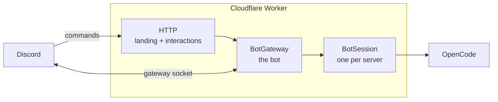

<p align="center">
  
</p>

# Eryn

Eryn is your personal agent in Discord. Built on top of [OpenCode](https://opencode.ai) running in a Cloudflare Durable Object.

## How it works



Eryn is one Cloudflare Worker and two Durable Objects. The Worker answers
`/interactions`, which Discord signs with the application's Ed25519 key, and
serves the landing page, the install redirect, the MCP sign-in callback, the
models.dev catalogue, and the health check.

`BotGateway` is the single bot: it holds the Discord gateway socket (one
connection per shard), registers the global commands, and dispatches
interactions. It forwards each guild's work to that guild's `BotSession`,
which owns the OpenCode host, the provider credentials, the MCP links, and a
virtual filesystem kept in SQLite-backed Durable Object storage. Credentials
and MCP tokens are sealed with AES-GCM under `ENCRYPTION_KEY`.

## Self-hosting

[](https://deploy.workers.cloudflare.com/?url=https://github.com/oscartbeaumont/eryn)

The button forks the repository into your GitHub account, creates the Worker
and its two Durable Objects, and serves the result on
`<worker>.<subdomain>.workers.dev`.

### 1. Create the Discord application

In the [Discord developer portal](https://discord.com/developers/applications):

1. Create an application. Under **Bot**, reset and copy the token, then enable
   **Message Content Intent**. Eryn reads messages in threads and subscribed
   channels, so this privileged intent is required.
2. Under **Installation**, keep the `bot` and `applications.commands` scopes.
   Eryn's own install link uses exactly those.

That is all the portal needs. The application id, the key that signs
interactions, and the interactions endpoint are read from Discord at runtime,
so there is nothing to copy from **General Information**.

### 2. Deploy

Click the button and fill in the two secrets it asks for:

| Secret              | Value                                                  |
| ------------------- | ------------------------------------------------------ |
| `DISCORD_BOT_TOKEN` | The bot token from the portal                          |
| `ENCRYPTION_KEY`    | `openssl rand -base64 32 \| tr '+/' '-_' \| tr -d '='` |

### 3. Connect the server

Open the Worker's URL, choose **Add to Discord**, and pick a server. Run
`/eryn setup` in that server and connect an inference provider.

The first request to the Worker tells Eryn its public URL: it points the
application's interactions endpoint at `<origin>/interactions` and answers
Discord's verification ping. Keep `<worker>.<subdomain>.workers.dev` or attach
a custom domain after that, and open the site once more.

### Deploying without the button

```sh
pnpm install
pnpm run deploy
```

Set `ERYN_DOMAIN=eryn.example.com` to attach a custom domain. A deploy from a
fork has no domain of its own, so it publishes on `workers.dev`; pass an empty
`ERYN_DOMAIN=` to do the same from any other deploy.

## Development

```sh
pnpm install
cp .dev.vars.example .dev.vars   # fill in the Discord app and generated keys
pnpm dev                         # cf dev
pnpm run check                   # typecheck + build
```

`pnpm run deploy` deploys the Worker; `pnpm deploy` is pnpm's own command and
does not work here.

A deploy replaces the Worker but not a running Durable Object. The Worker sends
its deploy id to each object, and an object that sees a new id waits for any
in-flight work and restarts on the new code. The health endpoint reports both
ids:

```sh
curl -s https://eryn.otbeaumont.me/health
# {"ok":true,"service":"eryn","deploy":"<worker deploy>","bot":{"connected":true,"shards":{"total":1,"open":1},"deploy":"<bot object deploy>","restart":false}}
```

`wrangler.jsonc` exists only so Cloudflare's deploy button and Workers Builds
can see the Worker's name, bindings, and resources. The project itself is
configured by `cloudflare.config.ts`, and `cf` ignores the Wrangler file.

## Configuration

Two secrets are required. Everything else has a sensible default.

| Variable             | Type   | Purpose                                                                 |
| -------------------- | ------ | ----------------------------------------------------------------------- |
| `DISCORD_BOT_TOKEN`  | secret | Required. Gateway socket, REST calls, and command registration           |
| `ENCRYPTION_KEY`     | secret | Required. Base64url 32-byte key for sealing stored credentials           |
| `PUBLIC_ORIGIN`      | var    | Origin for links and OAuth callbacks; learned from the first request     |
| `SESSION_SECRET`     | secret | Signs MCP sign-in state; derived from `ENCRYPTION_KEY` when unset        |
| `ERYN_DOMAIN`        | build  | Custom domain attached by `cf deploy`; unset on Workers Builds            |
