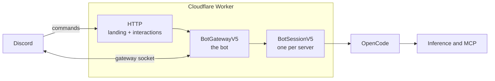

<p align="center">
  
</p>

# Eryn

Eryn is your personal agent in Discord. Built on top of [OpenCode](https://opencode.ai) running in a Cloudflare Durable Object.

## How it works



Eryn is one Cloudflare Worker and two Durable Objects. The Worker answers
`/interactions`, which Discord signs with the application's Ed25519 key, and
serves the landing page, the install redirect, the MCP sign-in callback, the
models.dev catalogue, and the health check.

`BotGatewayV5` is the single bot: it holds the Discord gateway socket (one
connection per shard), registers the global commands, and dispatches
interactions. It forwards each guild's work to that guild's `BotSessionV5`,
which owns the OpenCode host, the provider credentials, the MCP links, and a
virtual filesystem kept in SQLite-backed Durable Object storage. Credentials
and MCP tokens are sealed with AES-GCM under `ENCRYPTION_KEY`.

## Self-hosting

[](https://deploy.workers.cloudflare.com/?url=https://github.com/oscartbeaumont/eryn)

The button forks the repository into your GitHub account, creates the Worker
and its two Durable Objects, and serves the result on
`<worker>.<subdomain>.workers.dev`.

### 1. Create the Discord application

In the [Discord developer portal](https://discord.com/developers/applications):

1. Create an application. Under **General Information**, copy the
   **Application ID** and **Public Key**.
2. Under **Bot**, reset and copy the token, then enable **Message Content
   Intent**. Eryn reads messages in threads and subscribed channels, so this
   privileged intent is required.
3. Under **Installation**, keep the `bot` and `applications.commands` scopes.
   The landing page's **Add to Discord** button installs the bot with exactly
   those scopes once `DISCORD_CLIENT_ID` is set.

### 2. Deploy

Click the button and fill in the secrets it asks for:

| Secret               | Value                                                  |
| -------------------- | ------------------------------------------------------ |
| `DISCORD_BOT_TOKEN`  | The bot token from the portal                          |
| `DISCORD_CLIENT_ID`  | The application id                                     |
| `DISCORD_PUBLIC_KEY` | The application's public key                           |
| `ENCRYPTION_KEY`     | `openssl rand -base64 32 \| tr '+/' '-_' \| tr -d '='` |
| `SESSION_SECRET`     | `openssl rand -hex 32`                                 |

### 3. Point Eryn at its own URL

Copy the Worker's `workers.dev` URL, then set it as a `PUBLIC_ORIGIN` variable
under **Settings → Variables and Secrets** and redeploy. Eryn builds every
outbound link from it, and sets the application's interactions endpoint to
`<PUBLIC_ORIGIN>/interactions` itself when the bot object starts.

### 4. Connect the server

Open the Worker's URL, choose **Add to Discord**, and pick a server. Run
`/eryn setup` in that server and connect an inference provider.

### Deploying without the button

```sh
pnpm install
pnpm run deploy
```

Set `ERYN_DOMAIN=eryn.example.com` to attach a custom domain. A deploy from a
fork has no domain of its own, so it publishes on `workers.dev`; pass an empty
`ERYN_DOMAIN=` to do the same from any other deploy.

## Development

```sh
pnpm install
cp .dev.vars.example .dev.vars   # fill in the Discord app and generated keys
pnpm dev                         # cf dev
pnpm run check                   # typecheck + build
```

`pnpm run deploy` deploys the Worker; `pnpm deploy` is pnpm's own command and
does not work here.

A deploy replaces the Worker but not a running Durable Object. The Worker sends
its deploy id to each object, and an object that sees a new id waits for any
in-flight work and restarts on the new code. The health endpoint reports both
ids:

```sh
curl -s https://eryn.otbeaumont.me/health
# {"ok":true,"service":"eryn","deploy":"<worker deploy>","bot":{"connected":true,"shards":{"total":1,"open":1},"deploy":"<bot object deploy>","restart":false}}
```

`wrangler.jsonc` exists only so Cloudflare's deploy button and Workers Builds
can see the Worker's name, bindings, and resources. The project itself is
configured by `cloudflare.config.ts`, and `cf` ignores the Wrangler file.

## Configuration

| Variable             | Type   | Purpose                                                                 |
| -------------------- | ------ | ----------------------------------------------------------------------- |
| `DISCORD_BOT_TOKEN`  | secret | Gateway socket, REST calls, and command registration                    |
| `DISCORD_CLIENT_ID`  | secret | Application id for the install link; defaults to the hosted application |
| `DISCORD_PUBLIC_KEY` | secret | Verifies interaction signatures; defaults to the hosted application     |
| `ENCRYPTION_KEY`     | secret | Base64url 32-byte key for sealing stored credentials                    |
| `SESSION_SECRET`     | secret | Signs MCP sign-in state and callback links                              |
| `PUBLIC_ORIGIN`      | var    | Origin for links, OAuth callbacks, and the interactions endpoint        |
| `ERYN_DOMAIN`        | build  | Custom domain attached by `cf deploy`; unset on Workers Builds          |
