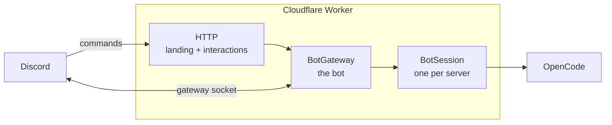

<p align="center">
  
</p>

# Eryn

Eryn is your personal agent in Discord. Built on top of [OpenCode](https://opencode.ai) running in a Cloudflare Durable Object.

## How it works



Eryn is one Cloudflare Worker and two Durable Objects. The Worker answers
`/interactions`, which Discord signs with the application's Ed25519 key, and
serves the landing page, the install redirect, the MCP sign-in callback, the
models.dev catalogue, and the health check.

`BotGateway` is the single bot: it holds the Discord gateway socket (one
connection per shard), registers the commands globally and in each guild, and
dispatches interactions. It forwards each guild's work to that guild's
`BotSession`, which owns the OpenCode host, the provider credentials, the MCP
links, and a virtual filesystem kept in SQLite-backed Durable Object storage.
Credentials and MCP tokens are sealed with AES-GCM under `ENCRYPTION_KEY`.

### Projects and workspace

Each Discord channel gets its own OpenCode project at
`/eryn/channels/<channel id>`. Threads in that channel share the project, so
the project list is grouped by channel instead of being one flat list of
conversations. The agent's files live in a separate shared virtual workspace,
not inside that project directory, so the grouping does not stop it reading or
writing elsewhere.

### Questions and approvals

When an MCP server needs information, Eryn posts the question in the
conversation instead of opening a separate form. Choice fields become buttons or
a select menu, free text is answered by replying in the thread, and the answer
is submitted once every required field is in. The agent can ask the same kind of
question itself with the `discord_ask` tool; that posts the question and ends the
turn, and the answer arrives as the next message.

### Customising Eryn

A guild's OpenCode files live in its virtual filesystem, so a member can ask
Eryn to change them and the host rebuilds on the next turn.

- `/eryn/AGENTS.md` — baseline instructions, including the default voice, the
  progress-reporting rules, and the attribution footer. Replace the `Replying`
  and `Progress updates` sections to change how Eryn talks.
- `/eryn/opencode.jsonc` — OpenCode config for the server.
- `/eryn/.opencode/skills/<id>/SKILL.md` — reusable skills.
- `/eryn/.opencode/commands/<name>.md` — OpenCode commands.
- `/eryn/.opencode/agents/<id>.md` — OpenCode agents.

Command `!` shell blocks run in the workspace's sandboxed shell. Markdown agents
under `.opencode/agents` are loaded like inline `agents` config, and a skill's
relative supporting-file paths resolve against that skill's directory.

The seeded `AGENTS.md` asks Eryn to give short progress updates at the start of
long work, at major milestones, and before a long quiet operation, while
staying silent for short tasks. Editing that section is the intended way to
change the cadence.

Its `Attribution` section asks Eryn to end GitHub issues, pull requests, and
comments with a footer naming the deployment, the model, and the session. Those
values come from the `<session ... />` element Eryn adds to the system prompt,
so they are never guessed. Remove that section if the server does not want the
attribution.

`/eryn reset` wipes every file, including `/workspace`, and restores the seeded
defaults. Provider credentials, the chosen model, MCP links, conversation
history, and policies are stored separately and are kept.

### Commands

- `/eryn setup` — providers, models, MCP servers, the default permission profile, and status (needs Manage Server)
- `/eryn policy` — choose a profile or override tools in this channel or thread (needs Manage Server)
- `/eryn reset` — wipe the server's files and restore the seeded defaults (needs Manage Server)
- `/eryn stop` — stop the run in this conversation
- `/eryn compact` — compact this conversation's history
- `/eryn command <name> [arguments]` — run an OpenCode command
- `/eryn commands` — list this conversation's OpenCode commands
- `/eryn help` — show the command list

## Permissions

Permissions are named **profiles**, owned by the server. `/eryn setup` sets the
server's default; `/eryn policy` chooses a profile for one channel or thread,
or overrides individual groups on top of it. A channel with no override uses
the server default.

Three profiles are built in:

- **Standard** is the default. Workspace reads and edits, the shell, web search,
  subagents, and ordinary Discord conversation are allowed; channel
  subscriptions and cross-channel Discord are not.
- **Full** allows everything Eryn can do.
- **None** allows nothing, including replies.

A server admin can also build custom profiles from the Standard shape, edit
each group, and then select them per channel. Deleting a profile makes channels
that used it fall back to Standard.

A profile is a ceiling, not the whole decision: every Discord tool also checks
the Discord permissions of the member who prompted the turn, so a Full profile
cannot let someone read a channel they cannot see themselves. Actions outside
the current conversation are a separate **Cross-channel Discord** policy group,
and an automated turn has no speaker, so it cannot use cross-channel tools.

### Schedules

A schedule runs as a capability scope, not as the person who created it. Its
scope starts as the conversation only, with the creator's own read, send,
thread-creation, reaction, and moderation permissions there. The scope
owner or someone with Manage Server can add another channel with
`discord_join_channel` or `discord_subscribe_message`, which stores the editor's
permissions in that channel; a schedule turn cannot change its own scope,
except that a thread it creates inside an in-scope channel inherits that
channel's capabilities. People talking to the conversation must cover that scope
with their own Discord
permissions, or their message is not forwarded to the agent. A scope that
includes message management therefore makes the conversation moderator-only,
and one that can create threads also requires members to be able to send in
threads.

A schedule turn is identified by the wake message OpenCode's runner writes, not
by a time window, so a human message sent right after a schedule fires is still
treated as a human turn.

Schedules are **public by default**: a public thread or channel stays public,
and the scope is not a visibility feature. Private content needs a private
thread or channel. The scope only covers Discord channels; workspace, shell,
web, subagents, and MCP remain governed by the conversation policy.

## Self-hosting

[](https://deploy.workers.cloudflare.com/?url=https://github.com/oscartbeaumont/eryn)

The button forks the repository into your GitHub account, creates the Worker
and its two Durable Objects, and serves the result on
`<worker>.<subdomain>.workers.dev`.

### 1. Create the Discord application

In the [Discord developer portal](https://discord.com/developers/applications):

1. Create an application. Under **Bot**, reset and copy the token, then enable
   **Message Content Intent**. Eryn reads messages in threads and subscribed
   channels, so this privileged intent is required.
2. Under **Installation**, keep the `bot` and `applications.commands` scopes.
   Eryn's own install link uses exactly those.

That is all the portal needs. The application id, the key that signs
interactions, and the interactions endpoint are read from Discord at runtime,
so there is nothing to copy from **General Information**.

### 2. Deploy

Click the button and fill in the two secrets it asks for:

| Secret              | Value                                                  |
| ------------------- | ------------------------------------------------------ |
| `DISCORD_BOT_TOKEN` | The bot token from the portal                          |
| `ENCRYPTION_KEY`    | `openssl rand -base64 32 \| tr '+/' '-_' \| tr -d '='` |

### 3. Connect the server

Open the Worker's URL, choose **Add to Discord**, and pick a server. Run
`/eryn setup` in that server and connect an inference provider.

The first request to the Worker tells Eryn its public URL: it points the
application's interactions endpoint at `<origin>/interactions` and answers
Discord's verification ping. Keep `<worker>.<subdomain>.workers.dev` or attach
a custom domain after that, and open the site once more.

### Deploying without the button

```sh
pnpm install
pnpm run deploy
```

Set `ERYN_DOMAIN=eryn.example.com` to attach a custom domain. A deploy from a
fork has no domain of its own, so it publishes on `workers.dev`; pass an empty
`ERYN_DOMAIN=` to do the same from any other deploy.

## Development

```sh
pnpm install
cp .dev.vars.example .dev.vars   # fill in the Discord app and generated keys
pnpm dev                         # cf dev
pnpm run check                   # typecheck + build
```

`pnpm run deploy` deploys the Worker; `pnpm deploy` is pnpm's own command and
does not work here.

A deploy replaces the Worker but not a running Durable Object. The Worker sends
its deploy id to each object, and an object that sees a new id waits for any
in-flight work and restarts on the new code. The health endpoint reports both
ids:

```sh
curl -s https://eryn.otbeaumont.me/health
# {"ok":true,"service":"eryn","deploy":"<worker deploy>","bot":{"connected":true,"shards":{"total":1,"open":1},"deploy":"<bot object deploy>","restart":false}}
```

`wrangler.jsonc` exists only so Cloudflare's deploy button and Workers Builds
can see the Worker's name, bindings, and resources. The project itself is
configured by `cloudflare.config.ts`, and `cf` ignores the Wrangler file.

## Configuration

Two secrets are required. Everything else has a sensible default.

| Variable             | Type   | Purpose                                                                 |
| -------------------- | ------ | ----------------------------------------------------------------------- |
| `DISCORD_BOT_TOKEN`  | secret | Required. Gateway socket, REST calls, and command registration           |
| `ENCRYPTION_KEY`     | secret | Required. Base64url 32-byte key for sealing stored credentials           |
| `PUBLIC_ORIGIN`      | var    | Origin for links and OAuth callbacks; learned from the first request     |
| `SESSION_SECRET`     | secret | Signs MCP sign-in state; derived from `ENCRYPTION_KEY` when unset        |
| `POSTHOG_KEY`        | secret | Optional. PostHog project token for product analytics; unset is silent    |
| `ERYN_DOMAIN`        | build  | Custom domain attached by `cf deploy`; unset on Workers Builds            |

The hosted site records page views and install clicks in PostHog, and the bot
sends coarse, content-free product events when `POSTHOG_KEY` is set. A fork
that leaves it unset reports nothing; the landing page also only initialises
its analytics on `eryn.otbeaumont.me`. Worker logs and Cloudflare error
aggregation (`observability.issues`) are always on and need no key.
